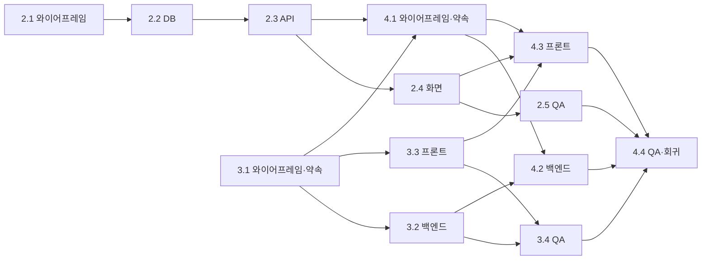

# Orca + Backlog.md 시연: 선행·병렬·상호 의존 스토리

작업 카드는 Backlog.md(`backlog/`)에 두고, 카드마다 Orca 작업 폴더(worktree) 하나와 agent 하나를 붙인다. 이 문서는 예시 스토리 셋으로 그 흐름을 끝까지 돌리는 순서다. 강사 시연용이며, 수강생은 과정 뒤 자기 저장소에서 같은 순서로 해 본다.

## 1. 스토리 셋

예시 업무는 `stack/`의 매입 증빙 장부다. 세 스토리 모두 **와이어프레임 → 개발 → QA** 순서를 지키고, 차이는 개발 카드끼리 어떻게 이어지느냐다.

| 스토리 | 진행 방식 | 카드 흐름 |
|---|---|---|
| TASK-2 공제받지 못할 매입을 따로 표시한다 | **선행형**: 한 층이 끝나야 다음 층을 시작함 | 2.1 와이어프레임 → 2.2 DB → 2.3 API → 2.4 화면 → 2.5 QA |
| TASK-3 달을 골라 그 달 증빙만 본다 | **병렬형**: 약속을 먼저 정하고 백엔드·프론트를 동시에 만듦 | 3.1 와이어프레임·API 약속 → (3.2 백엔드 ∥ 3.3 프론트) → 3.4 합친 뒤 QA |
| TASK-4 고른 달의 공제 가능 매입을 CSV로 내려받는다 | **상호 의존형**: 스토리 2·3의 결과가 있어야 시작함 | 4.1 와이어프레임·CSV 약속(2.3·3.1 필요) → (4.2 백엔드 ∥ 4.3 프론트) → 4.4 QA와 회귀 QA |

의존 관계는 카드의 `dependencies`에 들어 있다. `npm run board`의 카드에서도 보이고, agent는 의존 카드가 `완료`가 아니면 시작하지 않는다(AGENTS.md).



## 2. Orca에서 작업 폴더를 여는 법

| 진행 방식 | 작업 폴더 | 이유 |
|---|---|---|
| 선행형(스토리 2) | 스토리 하나에 폴더 하나(`task-2`). 카드마다 **새 agent 세션**을 그 폴더에서 연다. 카드를 시작하기 전마다 **main을 이 폴더에 합친다** | 다음 카드가 앞 카드의 코드 위에서 일해야 한다. 폴더를 나누면 매번 합쳐야 한다. 오래 따로 두면 다른 스토리와 부딪친다(3절) |
| 병렬형(스토리 3) | 약속 카드(3.1)는 main에서 끝내고 합친다. 그다음 `task-3-2`, `task-3-3` 두 폴더를 **동시에** 연다 | 두 agent가 서로 다른 폴더(`stack/api`, `stack/web`)를 고치므로 합칠 때 부딪치지 않는다 |
| 상호 의존형(스토리 4) | 스토리 2·3을 main에 합친 **뒤에** `task-4-2`, `task-4-3`을 연다 | 새 폴더는 만든 순간의 main에서 갈라진다. 먼저 열면 공제 여부·월 선택 코드가 없다 |
| QA 카드 | main 또는 `qa` 폴더 하나 | 합친 결과 전체를 확인한다 |

### 시작 전 준비 (한 번)

1. **Orca 저장소 설정의 Setup Script를 `npm install`로 둔다.** 새 작업 폴더는 깨끗한 checkout이라 `node_modules`가 없어 `npx backlog`가 돌지 않는다.
2. **카드와 약속 문서는 main에 커밋하고 푸시한 뒤 작업 폴더를 연다.** Orca는 기본으로 `origin/main`에서 갈라진다. 푸시하지 않은 카드는 새 폴더에 없다.
3. **Orca가 agent를 권한 확인 없이 띄운다는 것을 안다.** Orca는 Claude Code를 `--dangerously-skip-permissions`, Codex를 `--dangerously-bypass-approvals-and-sandbox`로 띄우는 것이 기본이다. agent가 묻지 않고 명령을 실행하므로, 수강생 노트북에서는 Settings → Agents에서 그 agent의 launch arguments를 지워 확인을 받게 하거나 고객 자료가 없는 저장소에서만 쓴다.
4. **보드는 main 폴더에서 띄운다**(`npm run board`). 각 작업 폴더에서 바꾼 카드 상태는 그 브랜치를 main에 합쳐야 보드에 보인다. 진행 중인 카드는 그 폴더의 터미널에서 `npx backlog task view <번호> --plain`으로 보여 준다.

### agent에게 줄 문장 (카드마다 같은 틀)

> TASK-3.2만 진행해 줘. AGENTS.md의 작업 흐름대로 계획을 카드에 먼저 적고 나한테 보여 줘. 이 작업 폴더 밖의 파일은 고치지 마. API 약속은 docs/wireframes/month.md를 따르고, 바꿔야 하면 먼저 물어.

Orca 화면 대신 명령으로 두 폴더를 한 번에 열 수도 있다(Orca 앱이 켜져 있어야 함).

```bash
orca worktree create --repo id:<저장소 id> --name task-3-2 --agent claude --prompt "TASK-3.2만 진행해 줘. …"
orca worktree create --repo id:<저장소 id> --name task-3-3 --agent claude --prompt "TASK-3.3만 진행해 줘. …"
```

저장소 id는 `orca repo list`로 본다.

### 스택을 동시에 띄울 때

작업 폴더 둘에서 `stack/`을 그대로 띄우면 이름(`stack`)과 화면 포트(5173)가 부딪친다. 폴더마다 다르게 준다.

```bash
cd stack
WEB_PORT=5174 docker compose -p task-3-3 up -d --build   # 화면은 http://localhost:5174
docker compose -p task-3-3 down -v                        # 끝나면 내림
```

폴더마다 DB도 따로 생기므로 `init.sql`을 바꾼 카드(2.2)도 깨끗한 DB에서 확인된다.

## 3. QA 반복

QA 카드는 기능을 만들지 않고 인수 조건을 표처럼 하나씩 해 본다(AGENTS.md "QA 카드").

1. 합친 main에서 깨끗한 스택을 띄우고 인수 조건을 위에서부터 해 본다.
2. 실패한 줄마다 `[버그]` 카드를 스토리 아래에 만든다. QA agent는 코드를 고치지 않는다.
3. `[버그]` 카드를 새 작업 폴더에서 다른 agent에게 맡겨 고치고 합친다.
4. QA 카드의 체크를 모두 풀고 처음부터 다시 돈다. 모든 줄이 통과하면 끝난다. 세 번 돌아도 안 되면 사람이 본다.

첫 QA가 바로 통과할 수도 있다. 그때는 QA agent가 짚은 "확인이 약한 곳"을 사람이 인수 조건으로 더하고 다시 돈다. 리허설(2026-10-26)에서는 이렇게 흘렀다.

| 회차 | 결과 |
|---|---|
| 1회차 | 3.4의 네 줄 모두 통과. QA agent가 "예시가 모두 10월이라 전체 보기 확인이 약하다", "합계 줄 금액이 위 칸과 어긋나 보인다"를 짚음 → 사람이 인수 조건 둘을 더함 |
| 2회차 | 합계 줄 정렬이 실패(83px 어긋남) → `[버그]` 카드에 재현 순서·기대·실제·원인 추정을 적음 |
| 수정 | 다른 agent가 새 폴더에서 CSS 한 줄로 고치고 main에 합침 |
| 3회차 | 여섯 줄 모두 통과 |

## 4. 리허설에서 드러난 것

실제로 끝까지 돌려 보니 문서만으로는 보이지 않던 장면이 넷 있었다. 넷 다 시연에서 그대로 보여 줄 만하다.

| 장면 | 무슨 일이 있었나 | 대응 |
|---|---|---|
| 선행형 폴더가 main과 멀어짐 | `task-2`에 main(스토리 3)을 합치자 `stack/api/main.py`가 충돌했다. 2.4 agent는 3.3이 이미 만든 `stack/web/src/receipts.js`를 새로 만들려 했다 | 카드를 시작하기 전마다 main을 선행형 폴더에 합친다. agent도 시작 전에 main보다 뒤처졌는지 보고 묻는다(AGENTS.md) |
| 약속끼리 부딪침 | 스토리 3의 약속(`month.md`)은 "응답에 새 필드를 더하지 않는다"인데, 스토리 2가 `deductible_vat`를 더했다. agent가 "약속을 갱신"과 "월을 줄 때만 필드를 뺌" 두 안을 내놓았다 | 사람이 약속 갱신을 골랐고, 바꾼 이유를 약속 문서에 한 줄 남겼다. 약속은 agent가 아니라 사람이 바꾼다 |
| 테스트끼리 DB를 더럽힘 | 1차: 스택 테스트들이 저마다 깨끗한 DB를 전제로 해 한 번에 돌리면 실패했다. 2차(규칙 수정 뒤): 전후 개수 차이로 보는 테스트가 동시에 도는 다른 파일 때문에 가끔 실패했고, 같은 내용의 증빙을 매번 넣는 테스트는 같은 스택에서 두 번째 돌릴 때부터 실패했다 | 스택 테스트는 전용 달을 쓰고, 거래처 이름에 실행마다 다른 표시를 붙여 방금 넣은 줄로만 확인한다. 깨끗한 스택과 같은 스택에서 한 번씩 돌려 둘 다 통과해야 끝난다(AGENTS.md) |
| agent가 묻지 않고 실행함 | Orca가 Claude Code를 권한 확인 없이 띄웠다. 막은 명령(`deny`)만 멈췄다 | 시작 전 준비 3번 |


### 2차 리허설 (2026-10-26, 고친 규칙으로)

| 확인한 것 | 결과 |
|---|---|
| main보다 뒤처지면 묻는가 | 2.2·2.3·2.4 agent 모두 시작 전에 물었다. 2.3은 main을 먼저 합쳐 API 충돌 없이 진행했다. 카드 파일만 바뀐 커밋에도 물어서, 겹치는 파일이 없으면 "그냥 진행해"로 답하면 된다 |
| 약속 충돌을 미리 짚는가 | 3.1 agent가 약속을 쓸 때 "2.3이 같은 응답에 필드를 더한다"를 먼저 짚었다. 2.3 agent도 코드를 고치기 전에 약속 갱신을 제안했다 |
| 스택 테스트가 함께 통과하는가 | 동시 실행 문제는 [버그] 카드로 고쳐 70회 연속 통과했다. 같은 스택에서 다시 돌릴 때 실패하는 테스트가 하나 더 나와 규칙에 "실행마다 다른 표시"를 더했다 |
| QA 반복 | 3.4는 1회차 통과 뒤 약한 곳을 더해 2회차에 통과, 2.5·4.4는 1회차에 통과(4.4는 회귀 9줄 포함) |

## 5. 시연 순서 (약 40분)

| 순서 | 무엇을 | 화면 |
|---|---|---|
| 1 | 보드에서 스토리 셋과 의존 관계를 보여 준다 | main 폴더 `npm run board` |
| 2 | **선행형**: `task-2`를 열고 2.1~2.4를 카드마다 새 세션으로 진행한다. 계획 승인 → 결과 확인을 매번 하고, 카드 사이에 main을 합친다 | Orca `task-2` 하나 |
| 3 | **병렬형**: main에서 3.1 약속을 확정·커밋·푸시하고, `task-3-2`·`task-3-3`을 동시에 연다 | Orca 폴더 둘이 나란히 |
| 4 | 두 결과를 Orca 차이 보기에서 검토하고(줄 댓글 하나로 다시 고치게 함) 커밋해 main에 합친다 | Orca Source Control |
| 5 | **QA 반복**: 3.4를 돌려 실패 → `[버그]` 카드 → 수정 → 재QA 통과까지 | Orca 브라우저 탭 |
| 6 | 2.5 QA를 돌리고 스토리 2를 합친다 | |
| 7 | **상호 의존형**: 4.1 약속을 정한 뒤 `task-4-2`·`task-4-3`을 연다. 4.4에서 회귀 QA까지 돈다 | |
| 8 | 보드에서 모든 카드가 `완료`로 바뀐 것과 각 카드의 최종 요약을 보여 준다 | main 폴더 보드 |

시간이 부족하면 2번(선행형)은 2.1·2.2까지만 보여 주고, 3·5번(병렬형과 QA 반복)에 시간을 쓴다.

## 6. 다 끝나면

- 작업 폴더는 Orca에서 오른쪽 클릭 → 삭제로 지운다. 폴더와 브랜치가 함께 지워진다.
- 스택은 폴더마다 `docker compose -p <이름> down -v`로 내린다.
- 시연을 처음 상태로 되돌리려면 main을 시연 전 커밋으로 되돌리고(`git reset --hard <커밋>`), 남은 브랜치를 지운다.
